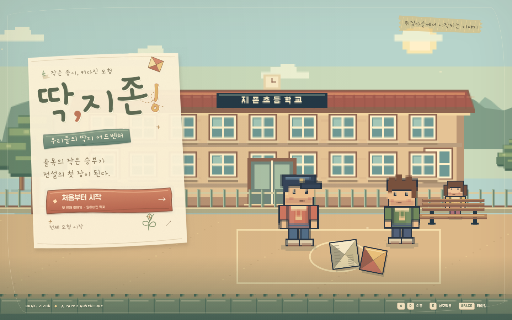
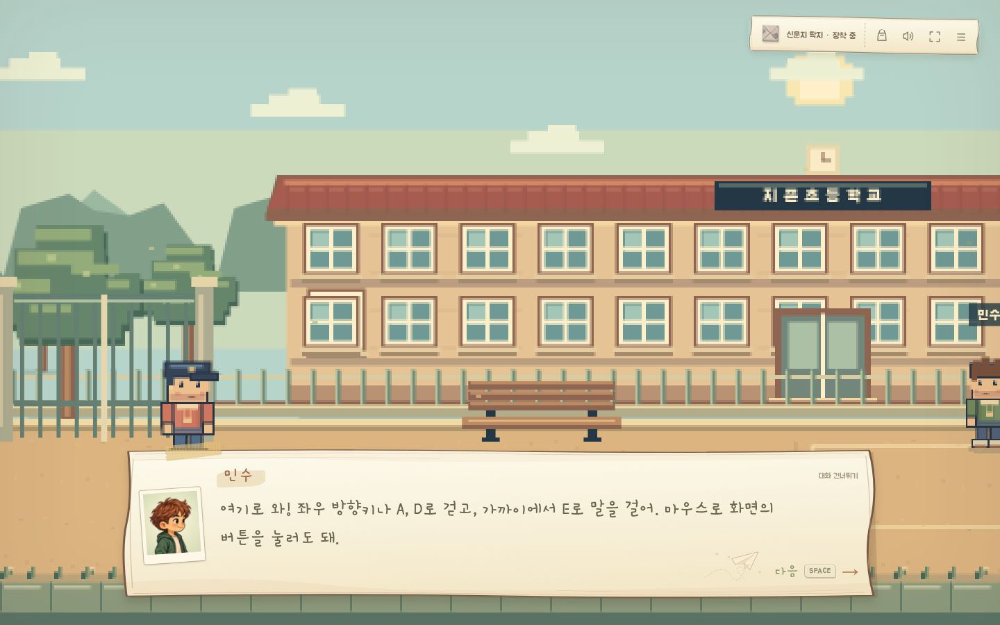
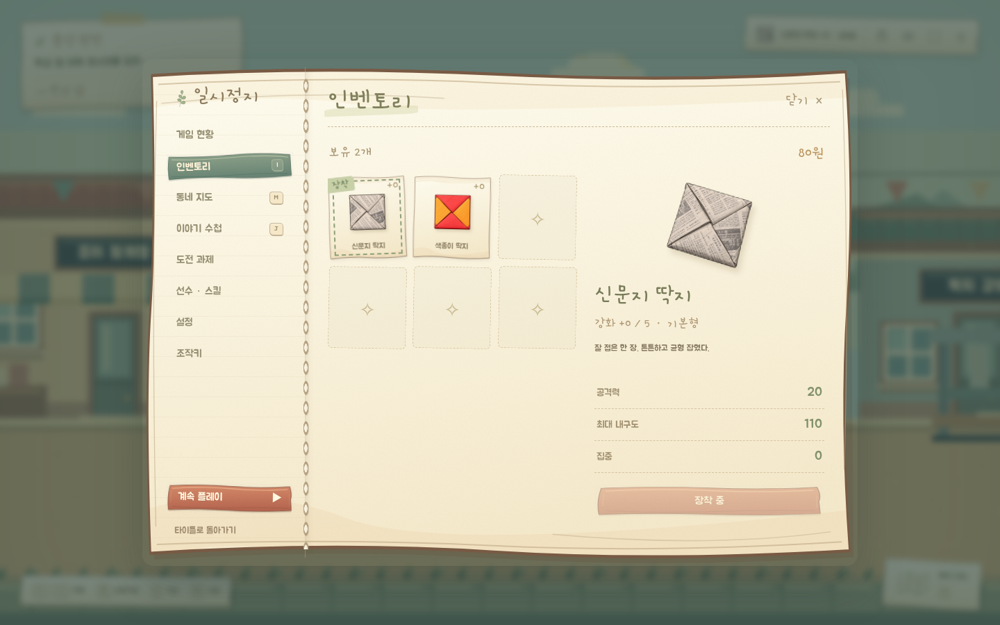
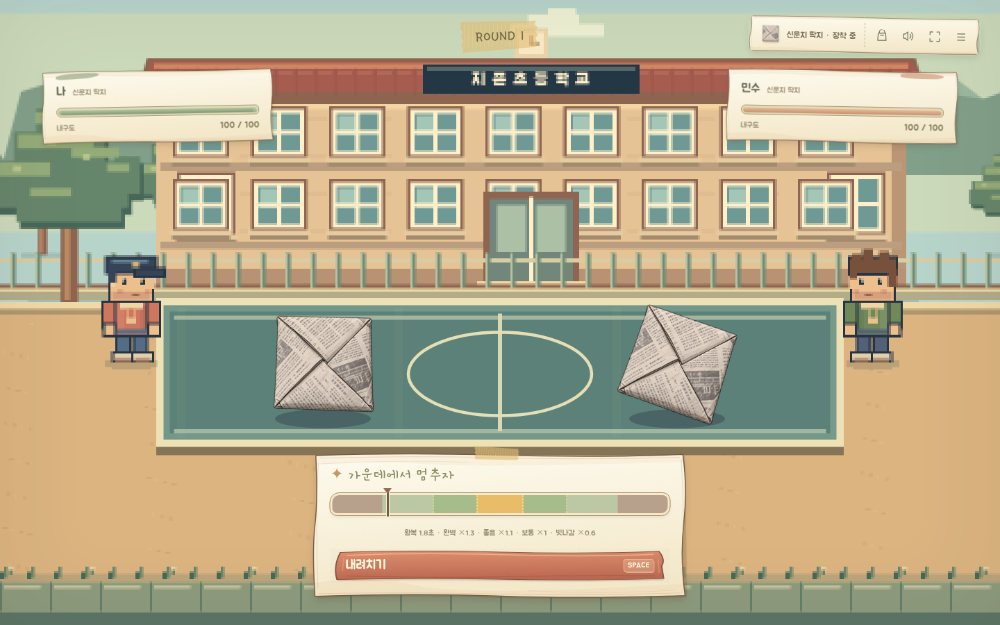
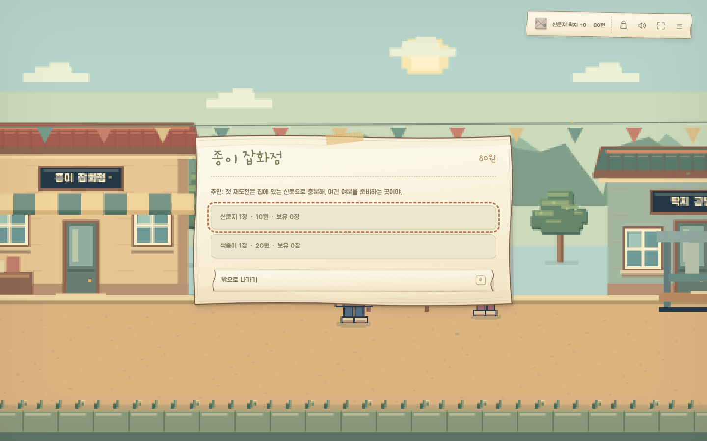
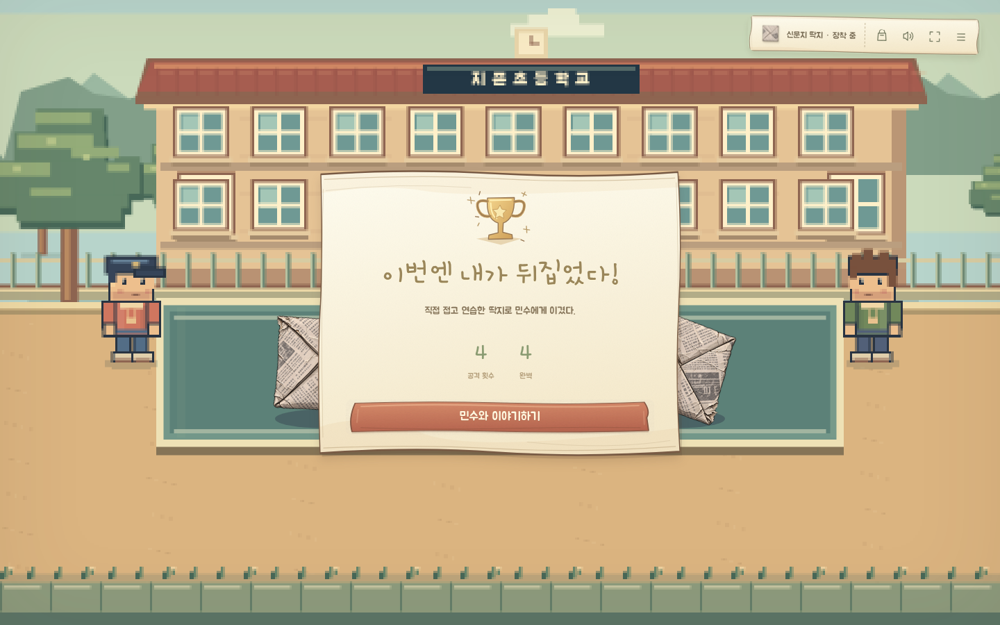

# 딱, 지존 — 손그림 UI와 도트풍 게임 화면



UI는 종이 수첩과 스케치북을 주제로 구성했습니다. 직접 그린 비대칭 종이 테두리, 물감 버튼, 마스킹 테이프,
종이비행기와 작은 식물 삽화를 같은 색으로 사용합니다. 한글 본문은 둥근 Jua, 제목과 대화는 Gamja Flower 손글씨입니다.



대화창은 종이에 쓴 편지, 초상화는 테이프로 붙인 사진처럼 구성합니다. 초상화는 기존 캐릭터 일러스트의 얼굴을 사용하고,
늦게 도착한 이미지가 다른 화자의 얼굴을 덮지 않도록 확인합니다. 이미지를 불러오지 못하면 로컬 캐릭터로 대체합니다.



일시정지 메뉴는 펼친 수첩입니다. 왼쪽에는 종이 탭과 제본, 오른쪽에는 붙여 놓은 수집 카드와 연필 구분선을 사용합니다.
가방·지도·수첩·선수·도전 과제·설정은 기존 키보드 탐색과 포커스를 유지합니다.



전투는 손으로 칠한 내구도 바, 종이에 그린 타이밍 게이지, 색칠한 행동 버튼으로 구성합니다.
판정 구간과 바늘 위치, 전투 수치, 게이지 일시정지 동작은 유지합니다.



시설·공방·접기·대진표·결과·장면 전환까지 같은 종이와 삽화를 사용합니다.



10개 탐험 구역과 대륙·세계·행성의 도트풍 월드는 유지합니다. 넓은 구역은 전체 너비를 그리며,
960×600 논리 화면을 PC 창에 같은 비율로 확대합니다. 확대된 기존 256×256 배경·소품 이미지는 사용하지 않습니다.
기존 184개 수집 딱지 PNG와 이동·성장·진행·저장 데이터도 유지합니다.

[직접 그린 UI 소재](../assets/ui/README.md)와 글꼴은 모두 로컬 파일입니다. 글꼴의 SIL OFL 1.1 라이선스도 함께 보관합니다.
애니메이션 줄이기 설정을 지원합니다.

## 확인 방법

```sh
npm ci
npm start
# 별도 터미널
npm run check
npm test
npm run test:minimum
npm run test:art
node tests/menus.browser.cjs
node tests/forge.browser.cjs
node tests/school.browser.cjs
```

1440×900·1280×720·1024×600 PC 창에서 확인합니다. UI 글꼴·초상화·소재 요청, 메뉴 경계,
키보드 이동/포커스, 지도 버튼, 전투 게이지와 일시정지, 장비와 시설, 첫 패배부터 접수까지의 전체 경로를 검증합니다.
전체 캠페인까지 재검증하려면 `npm run test:browser`를 실행합니다.
Chromium 기준이며 다른 브라우저 엔진과 실제 기기의 수동 플레이는 별도 확인 범위입니다.
