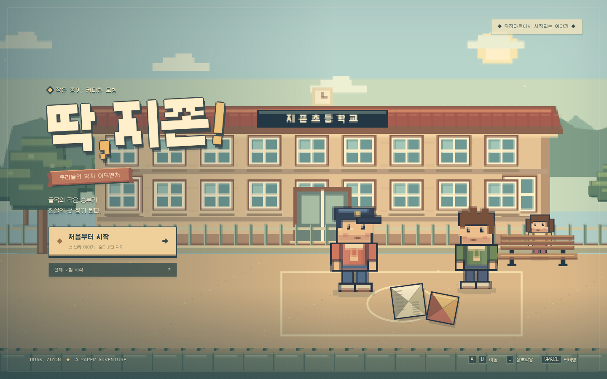
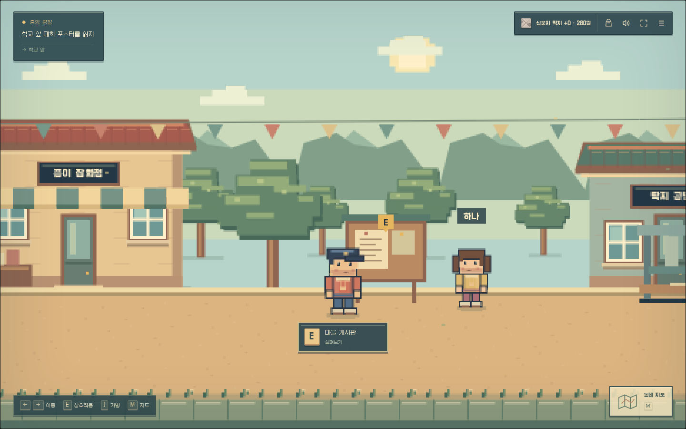
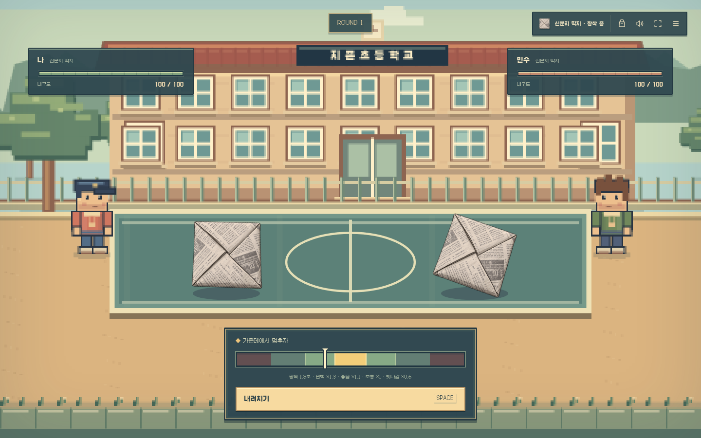
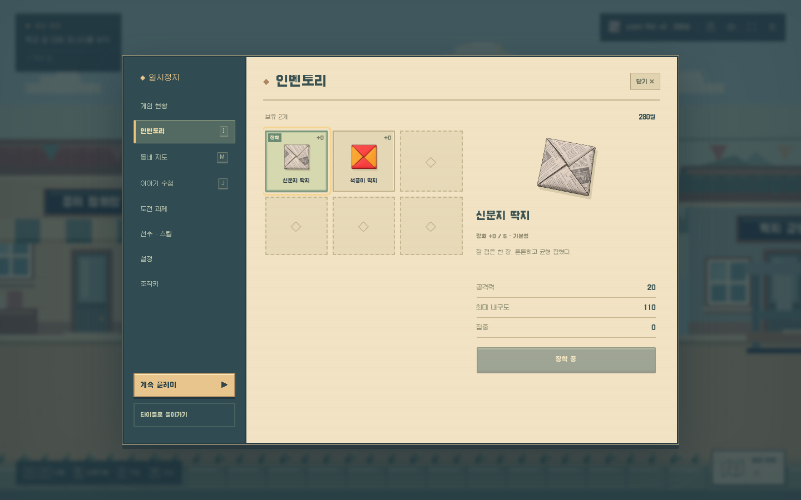

# 딱, 지존 — 도트풍 화면



확대된 정사각형 일러스트를 배경으로 쓰던 화면을, 플레이 좌표에 맞춘 도트풍 게임 공간으로 교체했습니다.
학교·집·골목·광장·주민센터와 체육관의 건물, 바닥, 소품은 같은 색과 픽셀 단위로 그립니다.
넓은 구역은 전체 너비를 캐시하므로 카메라가 끝으로 이동해도 빈 배경이 나오지 않습니다.
게임의 논리 화면은 960×600이며 PC 창에서는 같은 비율로 확대합니다.



인물은 걷기 두 자세, 눈 깜박임, 공격, 좌우 방향을 공유합니다. 대화 초상화도 같은 인물을 잘라 사용합니다.
대륙·세계·행성 로비와 각 대회 관중석까지 동일한 렌더러를 사용합니다.
기존 `assets/art/` 인물·소품·배경은 실행 시 불러오지 않으며 원본 파일은 보관합니다.
수집 딱지의 고유한 외형과 네 상태를 표현하는 기존 184개 PNG는 유지합니다.



탐험 HUD, 가까운 대상의 E 안내, 지도 버튼, 대화창, 내구도 바, 타이밍 게이지, 결과창과 가방을
청록 프레임·금색 행동 버튼·종이색 정보창으로 맞췄습니다. 화면 속 명칭은 “첫 번째 이야기”와 “전체 모험”으로 정리했습니다.



Galmuri11 한글 도트 글꼴을 로컬 파일로 포함했습니다. [SIL OFL 1.1 라이선스](../assets/fonts/OFL.md)를 함께 보관합니다.
애니메이션 줄이기 설정을 지원하며, 이동·전투 수치·성장·획득·저장 키와 진행 순서는 기존과 같습니다.

## 확인 방법

```sh
npm ci
npm start
# 별도 터미널
npm run check
npm test
npm run test:browser
```

`test:art`는 10개 탐험 구역의 끝까지 배경이 채워지는지, 로컬 글꼴, 실제 키보드 이동과 방향 전환,
자세별 변화와 발 기준점, 초상화, 게이지 일시정지, 1280×720·1024×600의 HUD와 지도 버튼을 확인합니다.
기존 배경·인물·소품 PNG 요청이 발생하지 않는지도 검사합니다.
전체 브라우저 검증에는 짧은 이야기와 기존 전체 모험의 전투·성장·저장·메뉴·수집 딱지 회귀 검사가 포함됩니다.
Chromium 기준이며 다른 브라우저 엔진과 실제 기기의 수동 플레이는 별도 확인이 필요합니다.
